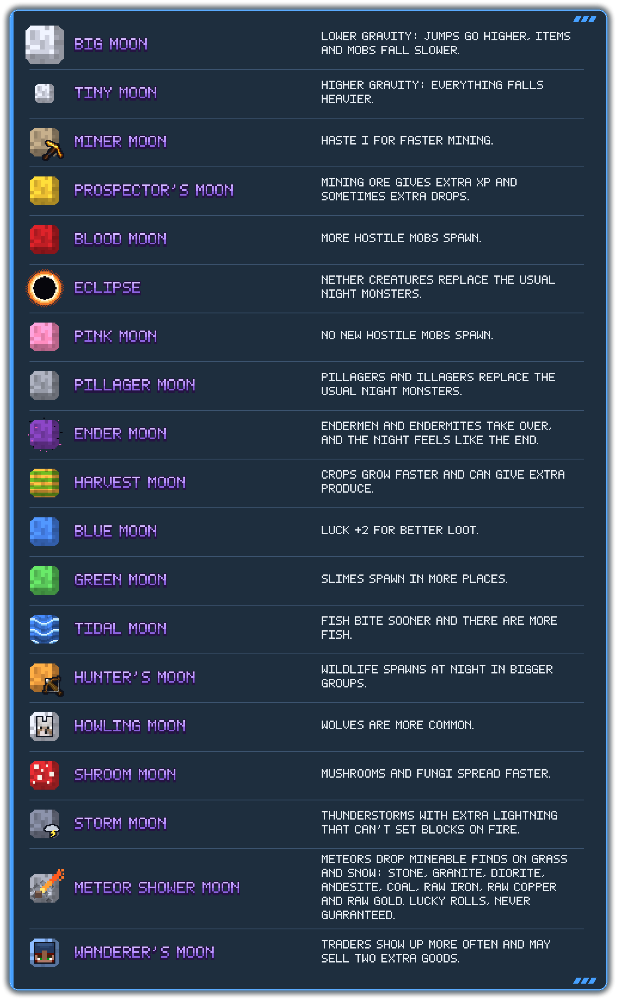

<picture></picture>

 

<picture></picture>

<picture></picture>

Needs Enhanced Celestials 2: Core 2.0.3.3 or newer, plus CorgiLib and Data Anchor, on Minecraft 1.21.1 with NeoForge. Works on client and server. This add-on contains none of the Core code and is not made by Corgi Taco. Commands: /ecplus status shows the current moon and what it does. /ecplus test tries a moon right now (creative mode only). /ecplus reload reloads the moon settings. /ecplus refreshforecast rolls the moon forecast again.

Made with AI assistance.
